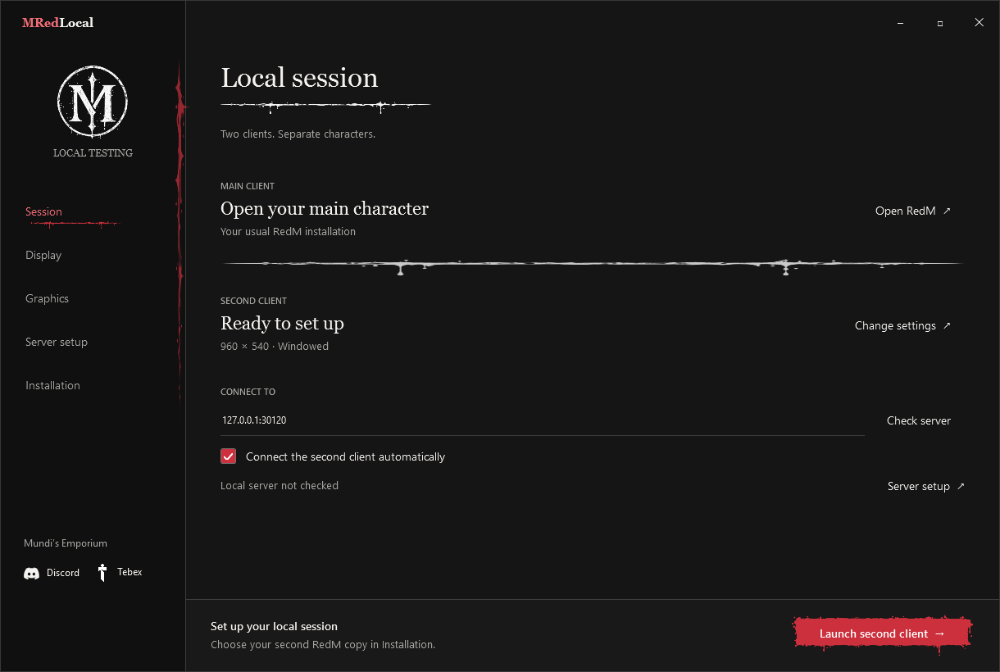
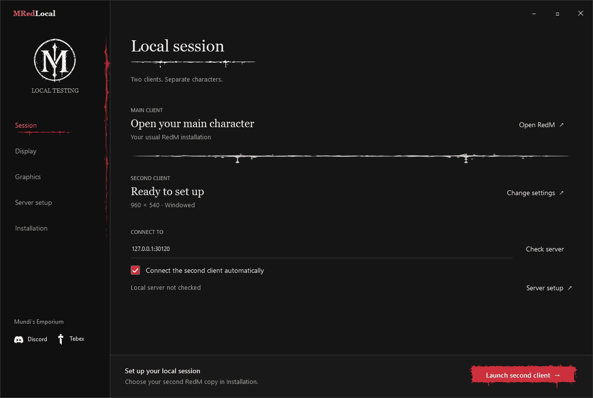

<p align="center"></p>

# MRedLocal

Run two RedM clients on one PC and connect them to your local VORP or RSG server.

[Windows download](https://github.com/Mundis-Emporium/MRedLocal/releases) · [Setup](docs/setup.md) · [VORP & RSG](docs/frameworks.md) · [Discord](https://discord.gg/Nng77jKReK) · [Tebex](https://mundis.tebex.io)



## Setup

1. Unzip the Windows build, open the **MRedLocal** folder and run `MRedLocal.exe`.
2. Open **Installation**. Choose your existing second RedM copy, or use **Install a second copy** and complete RedM's normal setup.
3. Stop your local server. In **Server setup**, choose its folder and click **Set up local testing** once.
4. Start the server, open your main RedM client and load your character.
5. Click **Launch second client**. Automatic connection uses the local address on the Session page.

Create the second character through your framework's usual character menu. It has its own inventory. Your existing characters stay separate.

## In the launcher

- Choose the second client's display, resolution, window mode and VSync.
- Use graphics presets or change individual settings.
- Download a separate RedM copy from the official source.
- Check, install and remove the supported framework changes with file backups.

Settings save as you change them. Keep the launcher open until the second game closes so it can restore your original graphics file.

Use windowed or borderless mode to choose which monitor the second client opens on. Fullscreen uses RedM's selected display.



## Requirements

You need Windows x64, RDR2, a working RedM login and a local server with two free player slots. Both clients run the game, so your PC needs enough memory for both.

The Windows download runs without installing .NET or Python. Connections stay on your PC, so you do not need port forwarding.

Setup checks your framework files before changing them. See [VORP and RSG setup](docs/frameworks.md).

## Help

Check [troubleshooting](docs/troubleshooting.md), or ask in [Discord](https://discord.gg/Nng77jKReK). Send the launcher message and your framework versions. Remove passwords and keys before sharing configs or logs.

## Build and test

Developers need the .NET 8 SDK:

```powershell
dotnet build src/Mundi.Launcher/Mundi.Launcher.csproj -c Release
dotnet run --project tests/Launcher.Tests/Launcher.Tests.csproj -c Release
dotnet run --project tests/Setup.Tests/Setup.Tests.csproj -c Release
dotnet run --project tests/Desktop.Tests/Desktop.Tests.csproj -c Release
```

Adapter tests need Python 3.10 or newer, Lua 5.4 and the matching framework source files:

```powershell
python -m unittest discover -s tests/vorp -v
python -m unittest discover -s tests/rsg -v
```

Set `VORP_BASELINE_DIR` to the saved Core source, `VORP_USER_CLASS` to Core's `server/class/user.lua`, `VORP_CHARACTER_SOURCE` to Character's `server/server.lua`, and `VORP_INVENTORY_DIR` to Inventory's folder. `RSG_BASELINE_DIR` points to the folder containing the three RSG resources. These files must match the adapter manifests.

Build the Windows package with `./scripts/Publish.ps1`. It creates `publish/MRedLocal-Windows-x64.zip`. Downloading GitHub's source ZIP requires building first; the Windows package is ready to run. [Source notices](NOTICES.md)

## License

MRedLocal uses the [Sustainable Use License 1.0](LICENSE). You can use it privately or within your business, including to develop resources you sell. Sharing copies or modifications must be free and noncommercial, with the copyright and license notices included. The framework adapters keep their [GPL licenses](NOTICES.md).
