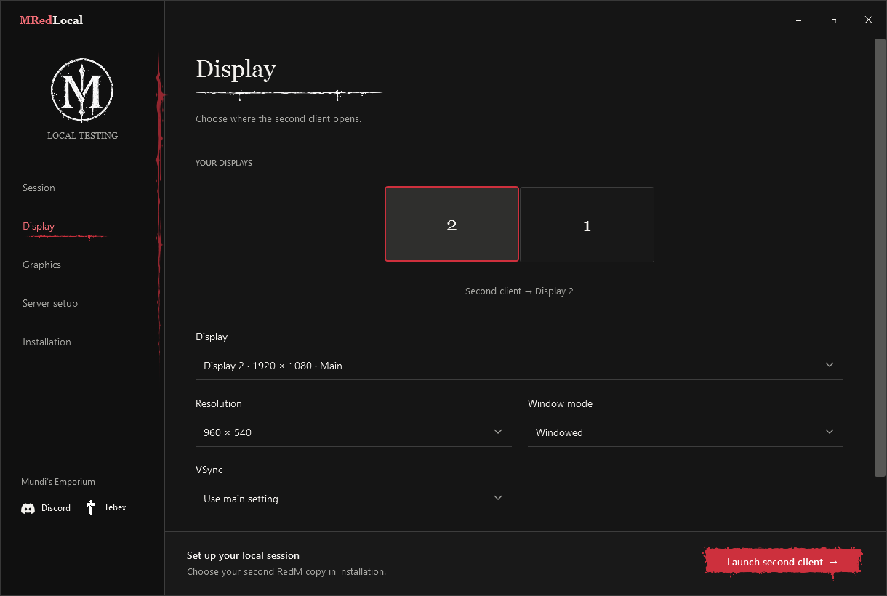
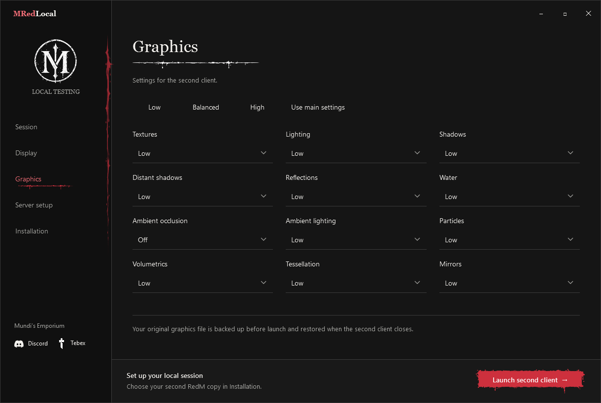

# Setup

## Install RedM

Unzip the Windows download and run `MRedLocal.exe`. Keep its folders together. GitHub's source ZIP needs to be built first.

In **Installation**, choose your main and second `RedM.exe` files. Use **Install a second copy** if you do not have one. Pick an empty folder outside the main installation, then finish RedM's download and sign-in using your existing RDR2 installation.

Do not put `cl2` in the folder name. Cfx treats it as a launch flag.

## Set up the server

Stop your local server. Open **Server setup**, choose its folder and click **Set up local testing**. The launcher checks the framework files and backs them up before making changes. See [supported versions](frameworks.md).

Start the server through your usual manager, or select `FXServer.exe` to use **Start server** in the launcher.

## Connect

Load your main character first, then click **Launch second client**. Use the normal character creator to make the second character.

Automatic connection uses your server's local address. If you turn it off, use F8 in the second client and enter `connect 127.0.0.1:30120`, replacing the port if yours differs.

Keep the launcher open until the second game closes. It will restore your original graphics file.

## Display and graphics

Choose the second client's monitor, resolution, window mode and VSync. Windowed and borderless modes can be placed on your chosen monitor. Fullscreen follows RedM's display setting.

Use a preset or adjust each setting. **Give the main client priority** lowers the second client's process priority.

RedM shares its graphics file between installations. Avoid changing graphics in game or restarting the main client while the second is open.

## Settings and backups

Use **Installation → Open local settings folder** to open `%LOCALAPPDATA%/Mundi/LocalTesting`.

- `launcher.json` and `desktop.json` hold your saved settings.
- `GraphicsBackup` holds the original graphics file and recovery record.
- `ServerBackups` holds the files changed by server setup.

To remove setup, close both clients, stop the server and use **Server setup → Remove setup**. Your test characters stay in the database. Later edits to patched files must be reviewed before rollback.
